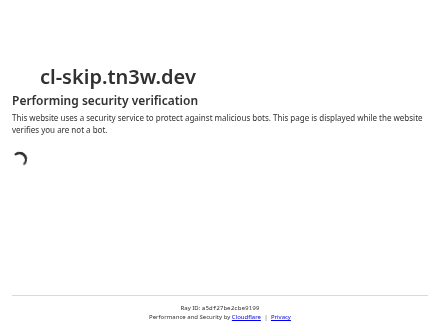
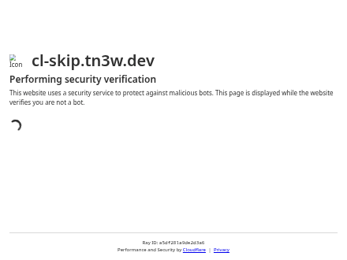

<div align="center">

<p>
  <picture>
    <source media="(prefers-color-scheme: dark)" srcset="https://raw.githubusercontent.com/tn3w/cloudflare-skip/master/assets/non-interactive-dark.gif">
    
  </picture>
  <picture>
    <source media="(prefers-color-scheme: dark)" srcset="https://raw.githubusercontent.com/tn3w/cloudflare-skip/master/assets/interactive-dark.gif">
    
  </picture>
</p>

# cloudflare-skip

**Skip Cloudflare challenges: solve once in headless Chrome, then reuse the clearance
with fast HTTP requests. No display needed.**

[](https://pypi.org/project/cloudflare-skip)
[](https://pypi.org/project/cloudflare-skip)
[](https://github.com/tn3w/cloudflare-skip/blob/master/LICENSE)

</div>

## Quick start

```bash
pip install cloudflare-skip
cloudflare-skip https://cl-skip.tn3w.dev               # non-interactive challenge
cloudflare-skip https://cl-skip.tn3w.dev/interactive   # interactive (checkbox) challenge
```

```python
from cloudflare_skip import get, solve

response = get("https://cl-skip.tn3w.dev", params={"q": "x"}, timeout=10)
print(response.status_code, response.text)

clearance = solve("https://cl-skip.tn3w.dev")  # {"cookies": {...}, "user_agent": "..."}
```

`get(url, **kwargs)` returns a `curl_cffi` response; keyword arguments (`params`,
`headers`, `cookies`, `timeout`, ...) go to `curl_cffi`. It raises `ChallengeError` if
Cloudflare still challenges after a solve and `TimeoutError` if the browser cannot solve
within 30s. The CLI prints the body, writes the status to stderr and exits 1 on 4xx/5xx.

Needs Chrome or Chromium (found on `PATH`, or set `CHROME_PATH`). Runs headless, so it
works on servers without a display; `solve(url, headless=False)` shows the window.
As root (e.g. in Docker) the sandbox is disabled automatically.

## How it works

1. Request with `curl_cffi` (Chrome TLS fingerprint) and the cached clearance.
2. `cf-mitigated: challenge` → headless Chrome opens the page, driven over the DevTools
   protocol directly (no automation framework).
3. Interactive Turnstile: once its checkbox renders (found through the frame's DOM,
   closed shadow roots included), it is focused and ticked with `Space`.
4. As soon as `cf_clearance` is set, cookies + user agent are cached per host in
   `~/.cache/cloudflare_skip.json` and replayed over HTTP.

| Run | Time |
|-----|------|
| First, browser solve (non-interactive, `/`) | ~2.7-3.1s |
| First, browser solve (interactive, `/interactive`) | ~3.2-3.9s |
| Cached, in-process | ~0.02-0.1s |

Almost all of the solve time is Cloudflare itself: Chrome is ready after 0.2s, the
challenge loads at ~0.8s, the rest is Cloudflare's check (and showing the checkbox).

## Notes

- The API is synchronous; from async code use `await asyncio.to_thread(get, url)`.
- A clearance is bound to the user agent and IP of the solving browser: `get` always
  sends the browser's user agent, and a proxy passed in `kwargs` makes the replay fail
  with `ChallengeError`. The cache holds session cookies, so it is created with mode 600.

Things Cloudflare detects, found the hard way:

- `--remote-debugging-port=0` and `--remote-debugging-pipe`: the clearance is issued but
  rejected on the next request, so the page reloads forever. A fixed free port works.
- The `HeadlessChrome` user agent. It is replaced with `--user-agent` (the reduced UA
  of headful Chrome, major version from `chrome --version`); a CDP user agent override
  breaks client hints and gets flagged too.
- CDP mouse clicks on Turnstile are always rejected; keyboard input passes.
- Attaching to the Turnstile frame on every poll; it is attached once and reused.

## Development

```bash
uv run pytest
uv run scripts/record.py <non-interactive|interactive> [light|dark]   # header GIFs
```

`site/` is the test page behind https://cl-skip.tn3w.dev, put behind Cloudflare
challenge rules: `/` gets a non-interactive challenge, `/interactive` an interactive
one. `pages.yml` builds it on every push to `site/`.

`scripts/record.py` screencasts headless Chrome solving the challenge and encodes the
frames with `gifski` (needs `gifski`, no display).
